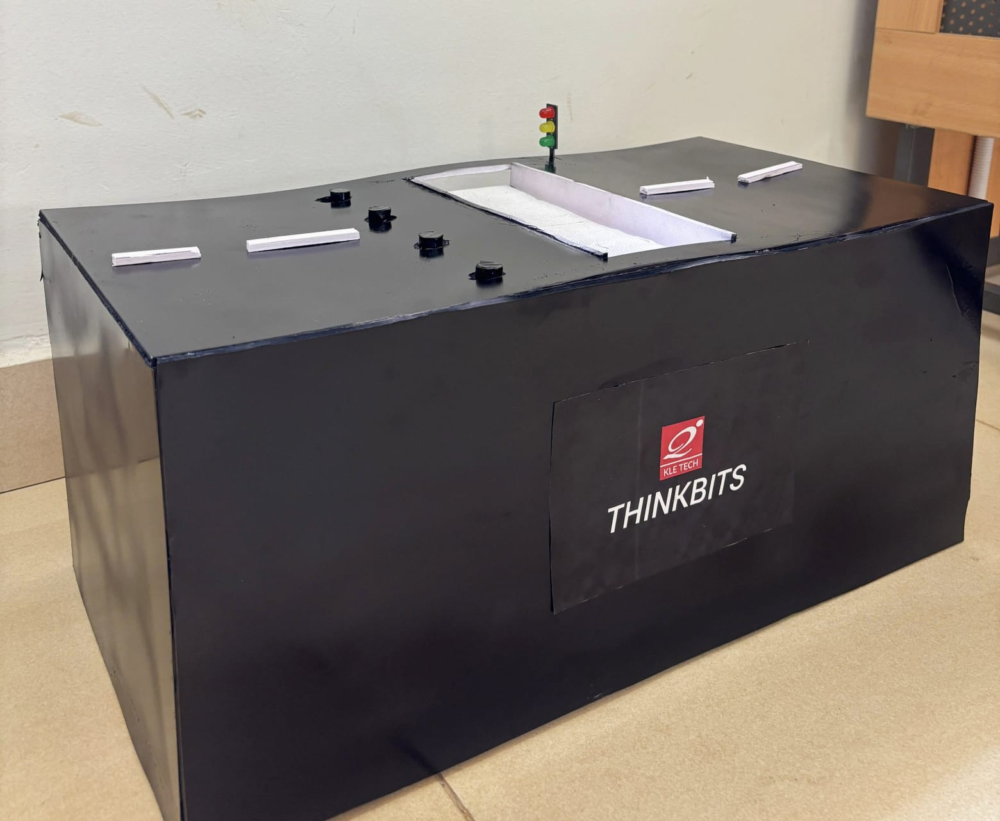

# 🚸 SMART ZEBRA CROSSING FOR PEDESTRIAN SAFETY

### 🌱 Sustainable Infrastructure Technologies

---

## 📌 PROJECT OVERVIEW

The **Smart Zebra Crossing for Pedestrian Safety** is an Arduino-based hardware prototype designed to improve pedestrian safety through automated traffic signals, road-blocking poles, and a moving escalator-style crossing platform.

The system coordinates traffic signals and motor operations to provide a controlled crossing sequence for pedestrians.

## ⚠️ PROBLEM STATEMENT

Traditional zebra crossings depend mainly on drivers noticing pedestrians and voluntarily stopping. This can create safety risks, especially for children, elderly people, and people with disabilities.

Our project proposes an automated crossing system to make pedestrian movement safer and more organized.

## 💡 PROPOSED SOLUTION

The system uses an Arduino-based controller to coordinate:

- 🚦 Traffic signal indicators
- 🚧 Automated road-blocking poles
- ⚙️ Motor-controlled crossing platform
- 🔄 Timed crossing operation

## 🔧 HARDWARE COMPONENTS

- Arduino microcontroller board
- Red, Yellow, and Green LEDs
- DC motors for pole and platform movement
- Motor control circuitry
- Connecting wires and supporting prototype components

## ⚙️ WORKING PRINCIPLE

The prototype follows a repeating timed sequence:

| Stage | Operation | Duration |
|---|---|---|
| 🟢 Green | Both motor channels OFF | 5 seconds |
| 🟡 First Yellow | Pole motor operates in one direction | 3 seconds |
| 🔴 Red | Escalator motor operates | 10 seconds |
| 🟡 Second Yellow | Pole motor operates in the opposite direction | 3 seconds |

The sequence then repeats continuously.

## 🔌 PIN CONFIGURATION

| Component | Arduino Pin |
|---|---|
| Red LED | 10 |
| Yellow LED | 9 |
| Green LED | 8 |
| Pole Motor IN1 | 6 |
| Pole Motor IN2 | 7 |
| Escalator Motor IN3 | 2 |
| Escalator Motor IN4 | 3 |

## 💻 TECHNOLOGIES USED

- Arduino Programming
- Embedded Systems
- Electronics
- Motor Control
- Hardware Prototyping

## 🌍 APPLICATIONS

- Smart city infrastructure
- School and college zones
- Railway and bus terminals
- High-traffic roads
- Commercial areas
- Areas used by elderly and differently-abled pedestrians

## 🚀 FUTURE SCOPE

- Integration of pedestrian detection sensors
- Addition of a pedestrian request button
- Improved automatic traffic control
- Enhanced safety mechanisms
- Development of a larger-scale working model

## 📸 PROJECT PROTOTYPE

## 🏫 PROJECT DETAILS

**Institution:** KLE Technological University  
**Department:** Electrical and Electronics Engineering  
**Project Theme:** Sustainable Infrastructure Technologies

---

## ⭐ PROJECT GOAL

To explore an automated and technology-driven approach to improving pedestrian safety and supporting smarter urban infrastructure.
